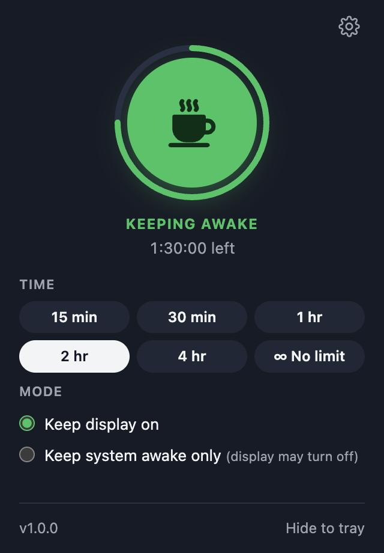
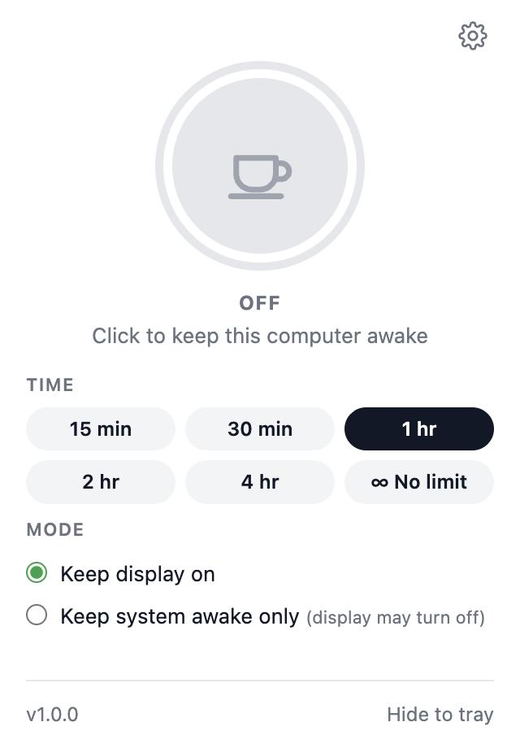
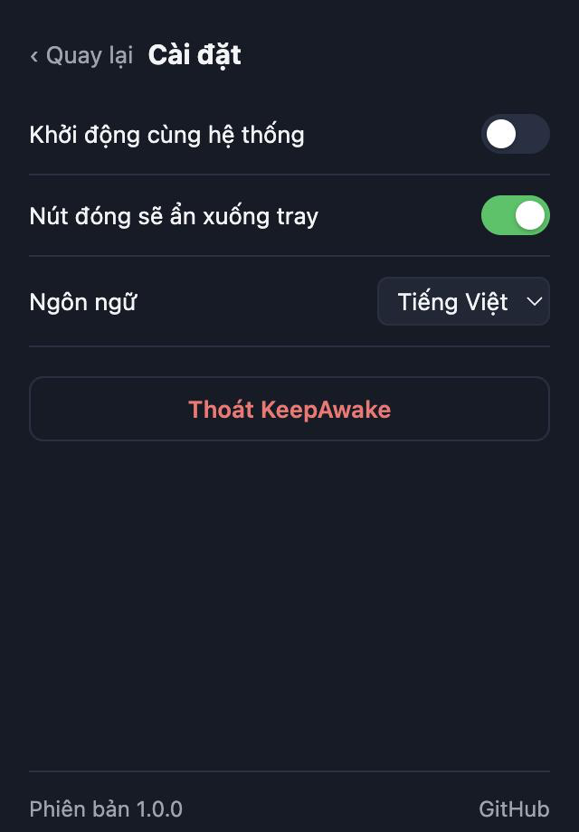

<p align="center">
  
</p>

<h1 align="center">KeepAwake</h1>

<p align="center">
  Keep your computer awake. One click, from a tiny window or the tray.<br>
  macOS · Windows · Linux
</p>

<p align="center">
  <a href="https://github.com/kingleykin/keepawake/releases/latest"></a>
  <a href="https://github.com/kingleykin/keepawake/actions/workflows/ci.yml"></a>
  <a href="LICENSE"></a>
</p>

<p align="center"><a href="README.vi.md">Tiếng Việt</a></p>

<p align="center">
  
  
  
</p>

## Features

- **One click.** Press the big button, or left-click the tray icon on macOS and Windows.
- **Timer.** 15 min, 30 min, 1 h, 2 h, 4 h, or no limit. It switches itself off when time is up.
- **Two modes.** Keep the display on, or keep only the system awake and let the screen turn off.
- **Lives in the tray.** The menu shows the countdown and lets you pick a time, which also switches keep-awake on.
- **Launch at login.** Starts quietly in the tray.
- **English and Vietnamese.** English is the default. Change it in Settings.
- **Small.** Built with [Tauri](https://tauri.app) and Rust. The installer is a few megabytes.
- **Honest status.** "Keeping awake" only shows after the operating system has accepted the request. If it refuses, you see the error instead.

## Install

Download the file for your system from the **[latest release](https://github.com/kingleykin/keepawake/releases/latest)**.

| System | File |
|---|---|
| macOS 10.15+ (Apple Silicon and Intel) | `KeepAwake_x.y.z_universal.dmg` |
| Windows 10 / 11 | `KeepAwake_x.y.z_x64-setup.exe` (recommended) or `KeepAwake_x.y.z_x64_en-US.msi` |
| Linux, any distro | `KeepAwake_x.y.z_amd64.AppImage` |
| Ubuntu / Debian | `KeepAwake_x.y.z_amd64.deb` |
| Fedora / openSUSE | `KeepAwake-x.y.z-1.x86_64.rpm` |

> The builds are not code-signed yet, because signing certificates cost money. Your system will warn you the first time. The steps below are needed once.

### macOS

1. Open the `.dmg` and drag **KeepAwake** into **Applications**.
2. Open KeepAwake. macOS says it cannot verify the developer. Click **Done**.
3. Open **System Settings → Privacy & Security**, scroll down, and click **Open Anyway** next to KeepAwake.

Or run this once in Terminal instead of steps 2 and 3:

```bash
xattr -dr com.apple.quarantine /Applications/KeepAwake.app
```

### Windows

1. Run `KeepAwake_x.y.z_x64-setup.exe`. It installs for your user only and does not need admin rights.
2. If SmartScreen says "Windows protected your PC", click **More info → Run anyway**.

On managed or Smart App Control machines, "Run anyway" may be missing. Ask your administrator, or build from source.

### Linux

AppImage:

```bash
chmod +x KeepAwake_*_amd64.AppImage
./KeepAwake_*_amd64.AppImage
```

Debian or Ubuntu:

```bash
sudo apt install ./KeepAwake_*_amd64.deb
```

Fedora:

```bash
sudo dnf install ./KeepAwake-*.x86_64.rpm
```

Plain GNOME hides tray icons. Install the [AppIndicator extension](https://extensions.gnome.org/extension/615/appindicator-support/) to see the KeepAwake icon. Ubuntu ships it already.

## What "awake" means

KeepAwake stops the computer from going to sleep **because nobody is using it**. In "Keep display on" mode it also stops the screen from turning off.

It does **not** stop sleep that you ask for yourself, such as closing a laptop lid or choosing Sleep from a menu.

| System | How it works | Check it |
|---|---|---|
| macOS | IOKit power assertions `PreventUserIdleSystemSleep` and `PreventUserIdleDisplaySleep` | `pmset -g assertions` |
| Windows | `SetThreadExecutionState` with `ES_SYSTEM_REQUIRED`, plus `ES_DISPLAY_REQUIRED` in display mode | `powercfg /requests` |
| Linux | XDG desktop portal `Inhibit` first. Falls back to `org.freedesktop.ScreenSaver` and systemd-logind | `systemd-inhibit --list` |

**Linux notes.** GNOME and KDE work on both Wayland and X11 through the desktop portal. Minimal Wayland compositors such as Sway or Hyprland may ignore these requests. If nothing accepts the request, KeepAwake shows an error instead of pretending to work. Left-click on the tray icon opens the menu on Linux, because Tauri cannot tell left and right clicks apart there.

## Build from source

You need [Rust](https://rustup.rs), [Node.js](https://nodejs.org) 18 or newer, and the [Tauri prerequisites](https://v2.tauri.app/start/prerequisites/) for your system.

```bash
git clone https://github.com/kingleykin/keepawake.git
cd keepawake
npm install
npm run dev
```

Build installers for your current system:

```bash
npm run build
```

Run the tests:

```bash
cd src-tauri && cargo test
```

On macOS, this also checks the real power assertions:

```bash
cd src-tauri && cargo test -- --ignored
```

### Project layout

```
src/                 window: plain HTML, CSS and JavaScript, no framework
src-tauri/src/
  awake.rs           talks to the operating system, on one dedicated thread
  tray.rs            tray icon and menu
  settings.rs        settings saved as JSON
  i18n.rs            tray menu text in English and Vietnamese
  lib.rs             state, timer, commands
scripts/             icon rendering
.github/workflows/   CI and release builds
```

## Releasing

1. Update the version in `package.json`, `src-tauri/Cargo.toml` and `src-tauri/tauri.conf.json`, and add an entry to `CHANGELOG.md`.
2. Commit, then tag and push:

```bash
git tag v1.0.1
git push origin main --tags
```

GitHub Actions builds macOS, Windows and Linux in parallel and publishes the release once all three succeed.

## Contributing

Bug reports and pull requests are welcome. Please keep the app simple: one job, done well. If you are reporting a Linux problem, include your distro, desktop, and whether you use Wayland or X11.

## License

[MIT](LICENSE). Free to use, change and share.
